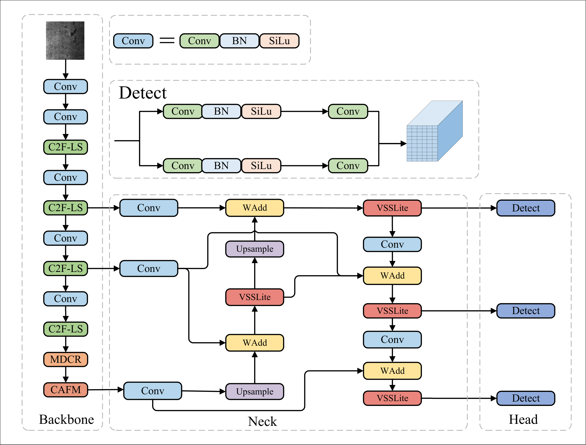
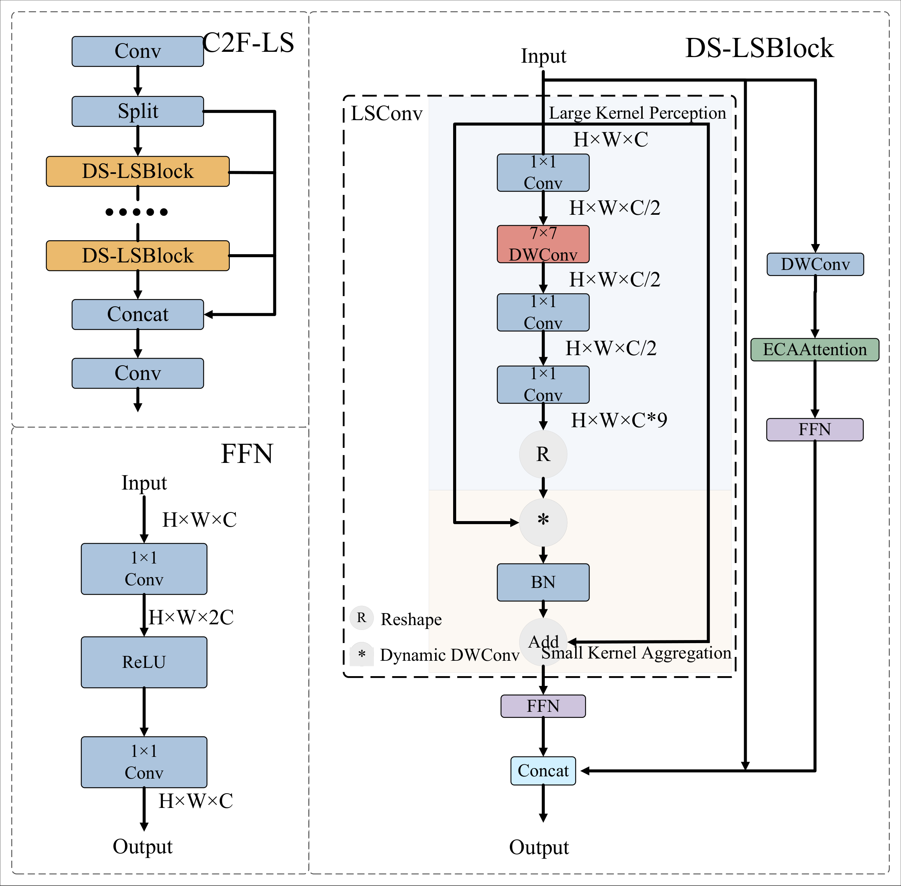
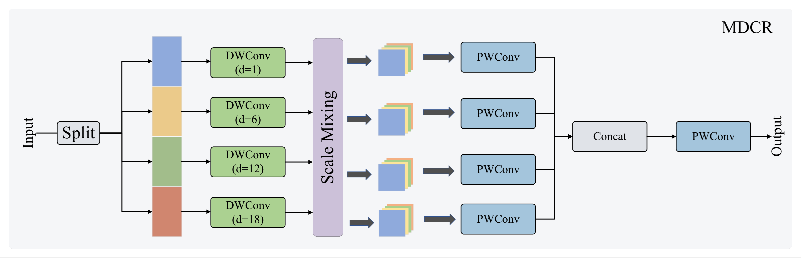
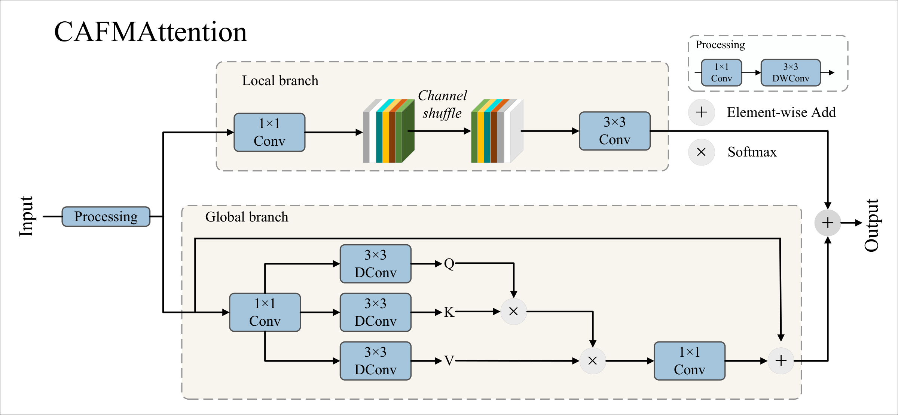
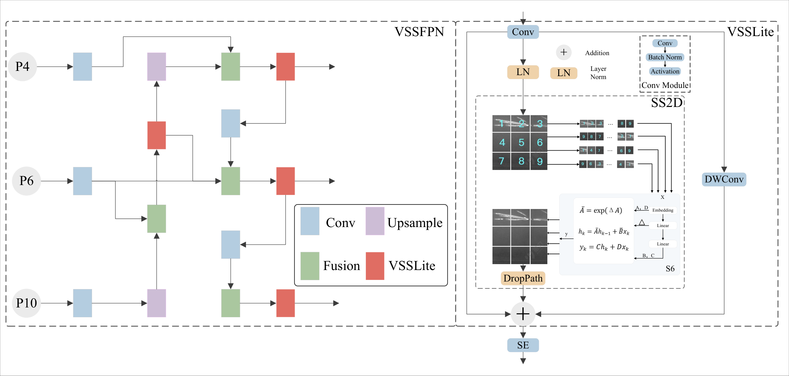

# VLS-YOLO

**VLS-YOLO: A Global-Local Collaborative Perception Network for Real-Time Steel Surface Defect Detection**

VLS-YOLO is a CNN–SSM hybrid object detector developed for steel surface defect detection. Based on YOLOv8n, it combines convolutional local texture extraction, multi-scale contextual representation, and state-space-based long-range modeling to handle low-contrast defects, scale variations, and directional steel surface textures.

## Overall Architecture

VLS-YOLO consists of an enhanced backbone, the **VSSFPN** feature-fusion neck, and a multi-scale detection head.

[View the overall architecture (PDF)](./VLS-YOLO.pdf)

## Main Modules

### 1. C2f_LS — Local and Large-Receptive-Field Feature Extraction

**C2f_LS** integrates a local RepVGG-style depthwise convolution and ECA branch with an LSConv branch to capture fine defect textures and broader spatial context.

[View C2f_LS structure (PDF)](./C2f_LS.pdf)

### 2. MDCR — Multi-Dilated Channel Refinement

**MDCR** processes channel groups using depthwise convolutions with different dilation rates, then reorganizes and fuses their responses through pointwise convolutions for multi-scale contextual aggregation.

[View MDCR structure (PDF)](./MDCR.pdf)

### 3. CAFMAttention — Local–Global Feature Refinement

**CAFMAttention** combines a local convolutional branch with a global Q–K–V attention branch to integrate local defect structures and broader feature interactions.

[View CAFMAttention structure (PDF)](./CAFMAttention.pdf)

### 4. VSSFPN and VSSLite — State-Space Feature Fusion

**VSSFPN** performs weighted bidirectional multi-scale feature fusion. Its lightweight **VSSLite** blocks incorporate four-direction SS2D scanning, depthwise convolution, and channel recalibration to model long-range spatial relationships while preserving local information.

[View VSSFPN and VSSLite structures (PDF)](./vssfpn_lite.pdf)
